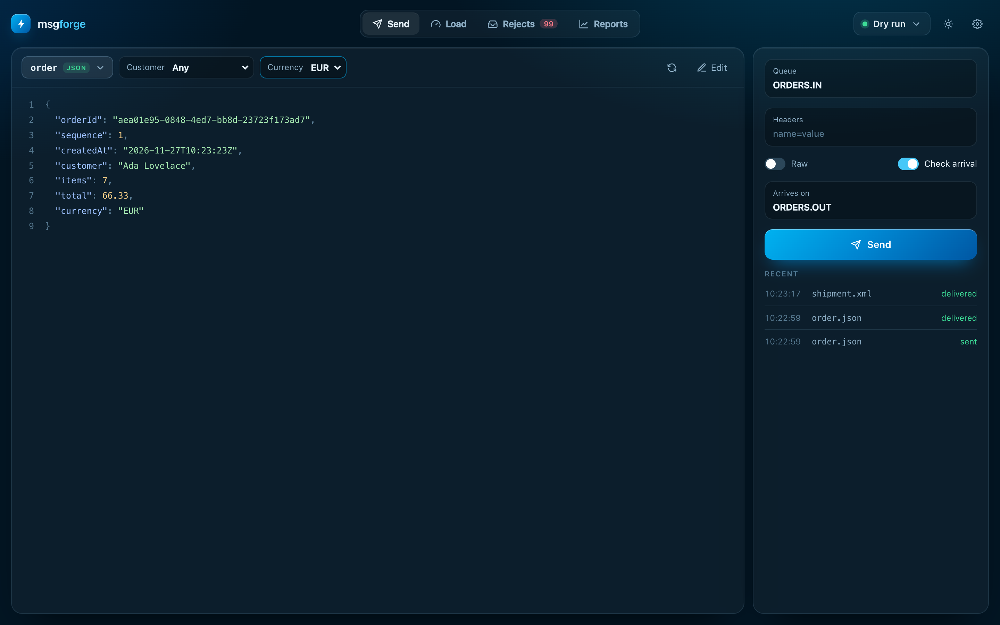

# msgforge

A message simulator: write a template, press Send, and msgforge publishes as many generated messages as you ask for to a queue. Message formats live in files and everything else is set up in the console, so a new format, queue or broker is a few clicks, not a code change.

It ships with IBM MQ and HTTP connection types, a dry-run type that needs no broker, and plugins for Kafka, RabbitMQ, MQTT, AMQP 1.0, Amazon SQS and NATS. It can also listen where the messages should end up and tell you whether they got there. Formats, brokers, generators and whole test scenarios are added next to the core, not by changing it.



## Run it

From a release: unzip `msgforge-<version>.zip` and start it. The zip holds the application, the bundled packs and the plugins.

```bash
msgforge-0.1.0/bin/msgforge
```

On Windows it is `bin\msgforge.bat`. It needs Java 17 or newer, found on the `PATH` or through `JAVA_HOME`. `packs/`, `plugins/` and `msgforge.json` are the ones in the unzipped folder; the scripts go there first, and so should you if you run `java -jar msgforge.jar` yourself.

When it is up it prints the address to open, and `bin/msgforge --help` lists the settings.

From source (the build is set up to fetch JDK 17 when the machine only has another version):

```bash
./gradlew bootRun     # run it
./gradlew dist        # build the zip into build/distributions/
```

Open http://localhost:8585. Pick a template, keep the `Dry run` connection, press Send.

The console has no login. It listens on 127.0.0.1 only, and it answers only requests addressed to `localhost`, `127.0.0.1` or `[::1]`, so a web page open in the same browser cannot reach it under another name, post to it from another site, or show it in a frame. Keep it on your own machine, or see [Running in a container](#running-in-a-container).

## Everything is configured in the console

| What | Where |
|---|---|
| Connections (broker address, channel, login) | the sliders button next to Connection |
| Destinations (queues) per connection | the same dialog, or the + next to Destination |
| Packs and their shared fields | the sliders button on a pack in the sidebar, or New pack |
| Templates | + on a pack to create, the editor to change, the bin to delete |
| Templates from files | the upload arrow on a pack, or drop message files anywhere on the page; what should differ per message is marked for you |
| Scenarios (saved runs) | the bookmark next to Send, or + on Scenarios in the sidebar |

Connections and scenarios are saved to `msgforge.json`, packs to the `packs/` folder. Both are plain files you can copy to another machine.

## Templates

A template is any text file with `{{placeholders}}`. The Insert menu in the editor lists them.

| Placeholder | Produces |
|---|---|
| `{{uuid}}` | a UUID |
| `{{id}}` | a 32-character id (a UUID without dashes) |
| `{{now}}` / `{{now yyyyMMddHHmmss}}` | the current UTC time, ISO 8601 or your pattern |
| `{{today}}` | the current UTC date |
| `{{seq}}` | a counter that starts at 1 in every run. The preview always starts at 1 too. |
| `{{int 1 9}}` | a whole number in the range, both ends included |
| `{{decimal 1 5000 2}}` | a decimal in the range with that many places, up to 18 |
| `{{pick GBP EUR "two words"}}` | one of the listed values |
| `{{digits 6}}` / `{{alnum 8}}` | random digits, or letters and digits, up to 10,000 |
| `{{iban GB}}` | an IBAN with valid check digits (GB, DE, NL) |
| `\{{` | a literal `{{`, for text that is not a placeholder |

A placeholder takes up to 500 arguments; with more, the text is sent as it is written.

`{{ref=id}}` generates a value and remembers it as `ref`; a later `{{ref}}` in the same message repeats it.

## From a real message to a template

Import a real message and msgforge marks what has to differ from one message to the next. A sample that would have sent the same id and the same timestamp every time becomes a template in one step:

```
<ShipmentId>3f2b8c1e-9a4d-4e7b-8c21-5d6f7a8b9c0d</ShipmentId>      <ShipmentId>{{ShipmentId=uuid}}</ShipmentId>
<Created>2024-03-09T14:05:33.120+01:00</Created>              →    <Created>{{now yyyy-MM-dd'T'HH:mm:ss.SSSxxx}}</Created>
<Value currency="EUR">1250.00</Value>                              <Value currency="EUR">1250.00</Value>
<Label>3f2b8c1e-9a4d-4e7b-8c21-5d6f7a8b9c0d</Label>                <Label>{{ShipmentId}}</Label>
```

Three ways in: the upload arrow on a pack, files dropped on the page, or a message copied from anywhere and pasted on the page (outside a text field; it asks for a file name). A message pasted into an empty editor is recognised the same way.

A file is imported as it is, and a pasted message is not written anywhere until you save; either way the placeholders are an unsaved edit in the editor, yours to save or discard. The wand next to Insert does the same for whatever is in the editor, and one thing more: it also uses the pack's fields (the last row of the table), and says which.

| In the sample | Becomes |
|---|---|
| a UUID | `{{uuid}}` |
| 32 hex characters | `{{id}}` |
| a date and time | `{{now}}`, or `{{now <pattern>}}` in the sample's own shape: with or without offset and fractions, `yyyy-MM-dd HH:mm:ss`, `yyyyMMddHHmmss` |
| an IBAN `{{iban}}` could have made (GB, DE, NL, valid check digits) | `{{iban GB}}` |
| a value one of your plugin's generators says is its own | that generator's placeholder |
| with the wand only: a whole value that is one of a pack field's `{{pick …}}` choices | `{{field}}` |

It is cautious on purpose, because in a routing test the values that decide the route must stay as the sample has them.

- Numbers are left alone: an amount, a quantity, a counter. The one exception is fourteen digits that read as a date and time of this century (`yyyyMMddHHmmss`).
- A date without a time is left alone. It is a version, a birthday or part of a name far more often than it is today.
- A currency, a country or a type code stays as it is on import, so a sample that stands for one route still does. The wand replaces such a value when the pack has a field that lists it, and only where it is the whole of an attribute value, of the text between two tags, of a JSON string or of a delimited cell (a quoted cell counts as one, commas and all). Text in a comment or a CDATA section is not looked at for this.
- A value directly after a backslash, as in a Windows path, is left alone, because a backslash before `{{` means a literal `{{`.
- Everything else is left byte for byte, so a rendered message is the sample with other values in the same places: well-formed XML stays well-formed, and JSON renders as JSON. Two limits to that: the template itself need not be valid JSON, since a time with a space in it is written `{{now "yyyy-MM-dd HH:mm:ss"}}`; and what a pack field or a plugin's generator produces has to fit where the value stood (a field choice with `&` in it does not fit in XML).

Every UUID and every 32-character hex string is replaced, including one that refers to an existing object and a checksum such as an MD5. Put back the ones that must stay.

A value that occurs more than once keeps meaning one thing: it is generated once under a name (taken from the element or key it first stands in) and repeated by that name. What already is a placeholder is left alone, so recognising twice changes nothing; a `{{…}}` from another template language is escaped as `\{{` so the template still renders. XML and JSON are told from the content, not the file name.

## Packs

A pack is a folder of templates you can mount and unmount:

```
packs/
  demo/
    pack.yml          name and fields
    templates/
      order.json
      shipment.xml
      reading.csv
```

Fields are named placeholders the pack's templates share, for example `carrier` = `{{pick "Northwind Freight" "Blue Harbor"}}`. The Overrides box fixes a field for one run, for example `carrier=Blue Harbor`.

Packs are read from disk on every request, so a folder you drop in shows up without a restart. To mount packs kept somewhere else, list the folders; new packs are created in the first one:

```bash
./gradlew bootRun --args='--msgforge.packs=packs,/path/to/my-packs'
```

A pack whose `pack.yml` cannot be read is listed with the error, and the other packs keep working. Templates are UTF-8 text.

One pack is bundled, `demo`: an order in JSON, a shipment notice in XML and a sensor reading as a CSV line, with four fields they share. Packs for a particular industry or company live outside this repository, in a folder of their own.

## Connections and secrets

Any connection setting can be written as `${MSGFORGE_SOMETHING}`. It is read from the environment when the connection opens, so `msgforge.json` can be shared without passwords in it:

```
Hosts     ${MSGFORGE_MQ_HOSTS}
Password  ${MSGFORGE_MQ_PASSWORD}
```

Only variables whose name starts with `MSGFORGE_` can be used this way. A connection can send what it is given to any address its author chooses, so a variable a connection may name is a variable anyone with access to the console can read; the rest of the environment is kept out of reach. To use names you already have, list them when starting msgforge: `MSGFORGE_ENV_ALLOW=MQ_*,KAFKA_PASSWORD` (comma-separated, `*` stands for any characters). A reference to any other name fails with a message that says so, and the variable is not read.

A password typed in directly is stored in `msgforge.json` (owner-readable only, and git-ignored here).

What msgforge does so that neither comes back out:

- The API returns only the settings a connection's type declares, and of those never a secret one. A misspelt key in a hand-edited `msgforge.json` is not shown, and stays in the file only until that connection is next saved from the console, which writes the declared settings and drops the rest. A connection whose type is not installed (its plugin jar is gone) shows no settings at all.
- Error messages from a connection show `${MSGFORGE_MQ_HOSTS}` where the value from the environment was, and `***` where a stored secret was, also when only a comma- or space-separated piece of the value appears, or in another letter case. This covers plugin types too. A type that encodes a value before quoting it is not covered.
- Connection types and their client libraries may write non-secret settings, such as broker addresses, to the server log. Keep secrets in the fields marked as passwords.
- A stored secret stays with the settings it was saved for. Change the type and it is dropped. Change another setting, such as the host or URL, and each stored secret has to be typed again or cleared; the save is refused until then. Renaming a connection or changing its destinations keeps it.

A run uses the connection as it was when the run started. Editing or deleting a connection does not affect a run that is already going; the next run picks up the change.

If `msgforge.json` cannot be read as JSON, msgforge does not start and says which file to fix or remove. It never overwrites a file it could not read.

### IBM MQ

| Setting | Notes |
|---|---|
| Hosts | one or more, `mq1(1414), mq2(1414)`. They are tried in order until one accepts, which covers multi-instance and standby queue managers. A missing port means 1414. |
| Queue manager | optional; leave empty when the hosts are different queue managers |
| TLS cipher suite | the standard Java name, for example `TLS_AES_256_GCM_SHA384`. Setting it turns TLS on. |
| Trust store file | JKS or PKCS12 with the queue manager's certificate chain. Without it the JVM's default trust store is used. |
| Key store file | JKS or PKCS12 with the client certificate, for channels that require mutual TLS |

Create one connection per environment or queue manager and pick it from the Connection dropdown.

If the consumer is not a JMS application, use a destination like `queue:///MY.QUEUE?targetClient=1` so MQ leaves out the JMS header.

### Plugin connection types

The release carries these as plugins. Their settings, how headers map and how each one receives are in [docs/connections.md](docs/connections.md).

| Type | Destination | Verified against |
|---|---|---|
| [Kafka](#the-kafka-plugin) | a topic | the client's mock producer and consumer only |
| [RabbitMQ](docs/connections.md#rabbitmq) (AMQP 0-9-1) | a queue, or `exchange/routing-key` | RabbitMQ 4.4.1 |
| [MQTT](docs/connections.md#mqtt) (5 and 3.1.1) | a topic | Mosquitto 2.1.4 |
| [AMQP 1.0](docs/connections.md#amqp-10) (ActiveMQ Artemis, ActiveMQ, Azure Service Bus, Solace, RabbitMQ 4…) | a queue address | RabbitMQ 4.4.1; ActiveMQ Artemis 2.40 embedded in the tests |
| [Amazon SQS](docs/connections.md#amazon-sqs) (and ElasticMQ, LocalStack) | a queue name or URL | ElasticMQ 1.7.1 only, not AWS |
| [NATS](docs/connections.md#nats) (core, JetStream publishing) | a subject | NATS Server 2.15.3 |

## Running in a container

```bash
docker build -t msgforge .
docker run -p 127.0.0.1:8585:8585 -v msgforge-data:/data msgforge
```

`127.0.0.1:` keeps the port on this machine. Without it Docker publishes it on every network interface, and anyone on the network could use the saved connections.

The image runs as a non-root user and keeps everything the console changes on the `/data` volume: `msgforge.json` and the packs in `/data/packs`. On a volume with no packs yet, the first start copies the bundled ones there, so they can be edited like any other; later starts, and newer images, leave that folder alone. The plugins are in `/app/plugins`.

| Variable | Purpose | Default | In the image |
|---|---|---|---|
| `SERVER_ADDRESS` | set to `0.0.0.0` so the port is reachable | `127.0.0.1` | `0.0.0.0` |
| `PORT` | HTTP port | `8585` | |
| `MSGFORGE_PACKS` | pack folders, comma-separated; new packs go in the first | `packs` | `/data/packs` |
| `MSGFORGE_CONFIG` | where connections and scenarios are saved | `msgforge.json` | `/data/msgforge.json` |
| `MSGFORGE_PLUGINS` | folder of plugin jars | `plugins` | |
| `MSGFORGE_ENV_ALLOW` | environment variables a connection may name besides `MSGFORGE_*`, for example `MQ_*,KAFKA_*` | none | |
| `MSGFORGE_ALLOWED_HOSTS` | host names the console answers to besides `localhost`, comma-separated; `*` for any | none | |

With the port published as above the console is at http://localhost:8585, for you only. Reached under any other name, for example `msgforge.internal` behind a proxy, it answers 403 until that name is in `MSGFORGE_ALLOWED_HOSTS`. The proxy has to pass the original `Host` header on: a write is accepted only when the browser's `Origin` matches it. `*` turns the host check off, which is only safe where nothing untrusted can reach the port.

msgforge has no login: anyone who can reach the port can send messages with the saved connections, and can read the environment variables connections are allowed to name, so expose it only behind your platform's access control.

A pack folder msgforge may not write to (mounted read-only, or owned by another user) can be used but not changed; the console says the pack is read-only.

The image was built and tried once by hand (Docker 28 on arm64): non-root process, packs seeded onto the volume, edits and connections kept across a new container, `docker stop` in under a second. There is no automated test for it.

## Sending to several brokers at once

Press Target in the send form to add another connection and destination. All connections are opened before the first message, so one that is down fails the run up front and names itself.

| Mode | What each message does |
|---|---|
| Spread | goes to the next target in turn |
| Copy to all | goes to every target |

## Headers

The Headers box adds message properties, written like Overrides: `JMSCorrelationID={{ref}}, region=EU`. They are rendered per message and share the body's bindings, so a header can repeat an id the body generated with `{{ref=id}}`.

| Connection type | What a header becomes |
|---|---|
| IBM MQ | a JMS string property; `JMSCorrelationID` and `JMSType` set the JMS header of that name |
| HTTP | a request header |
| Kafka | a record header; `key` sets the record key |
| RabbitMQ | an entry in the headers table; `correlation_id`, `message_id`, `type` and the other AMQP property names set that property |
| MQTT | an MQTT 5 user property. MQTT 3.1.1 has none: a header fails the run. |
| AMQP 1.0 | an application property; `JMSCorrelationID` sets the correlation id and `JMSType` the subject |
| Amazon SQS | a `String` message attribute (at most 10); `MessageGroupId` and `MessageDeduplicationId` set those parameters |
| NATS | a NATS header |

## Scenarios

A scenario is a saved run you can start again with one click. It can mix several templates by weight: weights 7 and 3 send exactly 70% and 30%, evenly interleaved. Each template can have its own overrides, which is how you produce messages that should take different paths downstream.

Its numbers (messages, rate, weights, timeout) are checked when it is saved. Its packs and connections are checked when it runs, so a scenario can be prepared before the pack or broker it needs exists. In the dialog, a connection or destination that has since been removed shows as `… (missing)` and is kept until you pick another.

A scenario refers to template files, so save a template before saving a scenario from the send form.

## Runs

The console keeps the last 20 runs that have ended, and every run that is still going. Cancelling stops a run at once when it is waiting, between messages or for arrivals; a message that is already on its way to the broker is finished first. Each run opens its own connections and closes them when it ends, and stopping msgforge cancels the runs in progress first.

## Verifying what arrives

Sending answers "did the messages go out". An expectation answers "did the system under test do the right thing with them": it says where one template's messages should arrive, msgforge listens there, and the run ends with a verdict.

The case it is built for is a router that reads one queue and forwards each message to one of several, depending on its content. Send a 7:3 mix to the input queue, expect each template on the queue it belongs on, and the run reports per template how many arrived, how many were misrouted (they arrived on a queue another template was expected on) and how many are missing, with the median and longest time from send to arrival.

| | |
|---|---|
| Turn it on | Verify in the send form, or the arrow under a template in a scenario |
| Verdict | `PASS` when every message arrived where expected, `FAIL` when the run completed and some did not. A run that failed or was cancelled has no verdict. |
| Timeout | how long to wait after the last send, 10 seconds unless set (1 to 600). The run ends sooner once everything has arrived somewhere. |
| Size | a run with expectations sends at most 20,000 messages |

A message is recognised when an arriving body contains its token: the first `{{uuid}}` or `{{id}}` value in the body it was sent with. A template made from a real message usually has one already: import puts `{{uuid}}` or `{{id}}` where the sample had an id. If the template has neither, or the system under test rewrites that value, set a match expression. It is rendered like a header, so `{{ref}}` repeats what the body generated with `{{ref=digits 12}}`. The send form and the scenario dialog both have a Match field.

What makes a good token:

- It must survive into the body that arrives.
- It must differ per message. An expression that gives the same text twice, such as a fixed word, is refused before the run starts, and a run stops as failed at the first message whose token equals one still awaited.
- It must be at least 8 characters. A short token, such as a counter, also turns up in other parts of a message (a `1` in a time or an amount), and the verdict would be wrong, so a run whose token is shorter is refused before it starts. Match on a UUID or a long id.
- It should not occur inside other content. When an arriving body contains several awaited tokens, the longest one is taken, so `order-10` is not mistaken for `order-1`.

If one message arrives more than once, its first arrival counts. A message that reached two watched destinations would be judged by whichever it reached first, so a run that copies every message (Copy to all) to two or more destinations that are also expected ones is refused before it starts. Use Spread, or send to one place and expect where the system under test delivers.

| Connection type | Receiving |
|---|---|
| Dry run | a loopback: what is sent to a destination is delivered to whoever listens on the same name, so a template that expects its own destination passes with no broker |
| IBM MQ | consumes: every message on the expected queue is taken off it, including ones msgforge did not send. Expect on queues that nothing else reads. |
| Kafka | reads the topic from its end with no consumer group, so other consumers are not affected. A topic the broker is still creating is waited for (5 seconds). On a broker that creates topics on demand, expecting a topic creates it: a mistyped topic name shows up as missing messages, not as "topic not found". |
| RabbitMQ | from a queue it consumes, like IBM MQ. From `exchange/routing-key` it binds a temporary queue of its own and takes nothing from other consumers. |
| MQTT | subscribes with a clean session; every subscriber gets a copy, so others are not affected. Wildcards work. |
| AMQP 1.0 | consumes, like IBM MQ. Expect on queues that nothing else reads. |
| Amazon SQS | polls and deletes what it receives: it consumes, and competes with other consumers of the queue |
| NATS | a core subscription: a copy of each message, nothing taken from streams or other subscribers. Wildcards work. |
| HTTP | cannot receive |

Listening starts before the first message is sent and stops when the run ends. If a receiver breaks while the run is going (the broker closes the connection, a message cannot be read), the run ends as failed with that error; it is not reported as missing messages. And before a run calls anything missing, it asks each broker it listens to whether it still answers (Kafka and IBM MQ; up to 5 seconds for Kafka). A broker that does not answer fails the run, whatever the timeout, and one that is frozen with its connections still open is given 15 seconds; a Kafka broker that goes quiet for good is also noticed during a long wait, after about 10 seconds.

## Extending msgforge

There are four ways to add something without touching the core:

| To add | Do this |
|---|---|
| A message format | add a template file to a pack |
| Shared values for a set of templates | add fields to the pack |
| A broker or protocol | implement `TransportType` |
| A new `{{placeholder}}` | implement `Generator` |

The last two are Java. Either add the class to this project as a Spring bean, or build it into a jar, list it in `META-INF/services/io.msgforge.TransportType` (or `io.msgforge.Generator`) and drop the jar into the `plugins/` folder. A plugin is one jar: each jar is loaded on its own, so what it depends on goes inside it (as the Kafka plugin does) or is named in its manifest's `Class-Path`. It cannot use classes from another plugin's jar. A jar that cannot be loaded is named in the log and skipped; msgforge starts without it. The jar route keeps organisation-specific code outside this repository. Plugins run with the same rights as msgforge, so only use jars you trust.

### The Kafka plugin

`extensions/kafka` is a complete plugin and the pattern to copy. It adds a Kafka connection type (bootstrap servers, SASL, TLS stores) and carries the Kafka client inside its own jar, so the core has no Kafka dependency.

```bash
./gradlew :extensions:kafka:installPlugin
```

That builds the jar into `plugins/` for running from source (the release zip and the image already have it there); restart msgforge and Kafka appears in the Type dropdown. The destination is the topic. A header named `key` becomes the record key and every other header becomes a record header. It can also receive, for expectations.

### A generator

```java
public class CustomerId implements Generator {
    public String name() { return "customerId"; }
    public String generate(List<String> args) { return "C" + System.nanoTime(); }

    // optional: imported samples then get {{customerId}} wherever a whole value is one of these ids
    public String recognise(String value) { return value.matches("C\\d{12,}") ? "customerId" : null; }
}
```

`recognise` is how an organisation teaches import its own formats. It is asked about whole values only. What it returns has to be its own placeholder without the braces, arguments included (`"customerId EU"`): its own name, no other generator's, no `name=` binding. Any other answer, and anything it throws, is taken as "not mine" and logged once, so a faulty generator cannot break an import.

## API

Everything the console does is plain HTTP:

```bash
curl -X POST localhost:8585/api/runs -H 'content-type: application/json' \
  -d '{"pack":"demo","template":"shipment.xml","connection":"dry-run","destination":"DEMO.QUEUE","count":100,"rate":20}'
```

`rate` is messages per second: 0 sends as fast as possible, anything else must be at least 0.001. A run also accepts `"headers":{…}` and, instead of one template, `"parts":[{"pack":"…","template":"…","weight":7,"vars":{…}},…]`. For several targets, send `"targets":[{"connection":"…","destination":"…"},…]` and `"mode":"spread"` or `"all"` instead of `connection` and `destination`.

To verify arrivals, add `"expect":{"connection":"…","destination":"…"}` to the run or to any of its parts, and optionally `"timeoutSeconds":10` and `"match":"{{ref}}"`. The run then goes `RUNNING`, `VERIFYING`, `DONE`, and carries a `verdict` (`PASS` or `FAIL`; null until it ends, and for a run that ends `FAILED` or `CANCELLED`) and `checks`, one per expecting part: `template`, `expected`, `sent`, `arrived`, `misrouted`, `missing`, `medianMs`, `maxMs`.

Runs: `POST /api/runs`, `GET /api/runs`, `DELETE /api/runs/{id}` (cancels, also while verifying).
Messages: `GET /api/messages` (the latest 50, without bodies), `GET /api/messages/{runId}/{n}/{target}` (one message with its body and headers).
Scenarios: `GET|POST /api/scenarios`, `PUT|DELETE /api/scenarios/{id}`, `POST /api/scenarios/{id}/run`.
Connections: `GET|POST /api/connections`, `PUT|DELETE /api/connections/{id}`, `POST /api/connections/test`, `GET /api/types` (each with `canReceive`).
Packs: `GET|POST /api/packs` (`POST` takes `id`, `name` and `fields`), `PUT|DELETE /api/packs/{id}`, `GET|PUT|DELETE /api/packs/{id}/templates/{name}`, `POST /api/preview`, `GET /api/generators`, `POST /api/recognise?pack={id}` (a sample as `text/plain` in; the template and the list of replacements with line, value, placeholder and, where a pack field was used, `field` out; nothing is saved; add `&fields=true` to have the pack's field choices replaced as well). A template `PUT` replaces; with the header `If-None-Match: *` it only creates, and answers 409 if a template of that name exists (in any letter case, where the file system ignores case).

Errors are `{"error": "…"}`: 400 for input msgforge can explain, 404 for an id that does not exist (a `PUT` never creates), 403 for a request from another host or site, 500 for anything unexpected, with the details in the server log.

## Adding a connection type

Implement `io.msgforge.TransportType` as a Spring bean or in a plugin jar. The console builds the connection form from `fields()`, so there is no UI work:

```java
@Component   // or, in a plugin jar, a line in META-INF/services/io.msgforge.TransportType
class AmqpType implements TransportType {
    public String id() { return "amqp"; }
    public String label() { return "AMQP"; }
    public List<Field> fields() {
        return List.of(new Field("uri", "Broker URI", "amqp://localhost:5672", true, false),
                       new Field("password", "Password", "${MSGFORGE_AMQP_PASSWORD}", false, true));   // secret: never returned
    }
    public Sender open(Map<String, String> settings) { /* return (destination, body, headers) -> … */ }
}
```

`open` is called for every run and every connection test, and the sender is closed when that run or test ends. `extensions/kafka` is a complete type to copy from.

To let expectations use the type, also override `canReceive()` to return true and `subscribe(settings, destination, onMessage, onError)` to hand each arriving body to `onMessage` until the returned subscription is closed. Call `onError` if receiving breaks after `subscribe` has returned, so the run fails instead of counting messages as missing.

## Tests

```bash
./gradlew test
```

The API is tested through the started application with the Kafka plugin loaded from its built jar. The JMS path, sending and receiving, is tested against an embedded ActiveMQ Artemis broker. Kafka sending and receiving are tested against the client library's mock producer and consumer, not a broker; IBM MQ is not tested against a queue manager.

The other plugins have unit tests with their client library mocked or an embedded broker, and tests against a real server that run only when an environment variable names one (they are skipped otherwise). Each test class says what it needs, for example:

```bash
MSGFORGE_IT_RABBITMQ=amqp://127.0.0.1:5672 MSGFORGE_IT_RABBITMQ_USER=… MSGFORGE_IT_RABBITMQ_PASSWORD=… ./gradlew :extensions:rabbitmq:test
```

`.github/workflows/ci.yml` runs the same command and is started by hand only.

The release zip has no automated test. It is checked by hand before a release: `./gradlew dist`, unzip into an empty folder, start `bin/msgforge` from another directory, and confirm that the console lists the `demo` pack with its three templates and that `GET /api/types` includes `kafka`.

## Licence

msgforge is licensed under the [Apache License 2.0](LICENSE).

A release also carries the libraries it runs on, each under its own terms; [THIRD-PARTY.md](THIRD-PARTY.md) lists them. All are open source except one: the IBM MQ client, which is IBM's and comes under IBM's licence.
